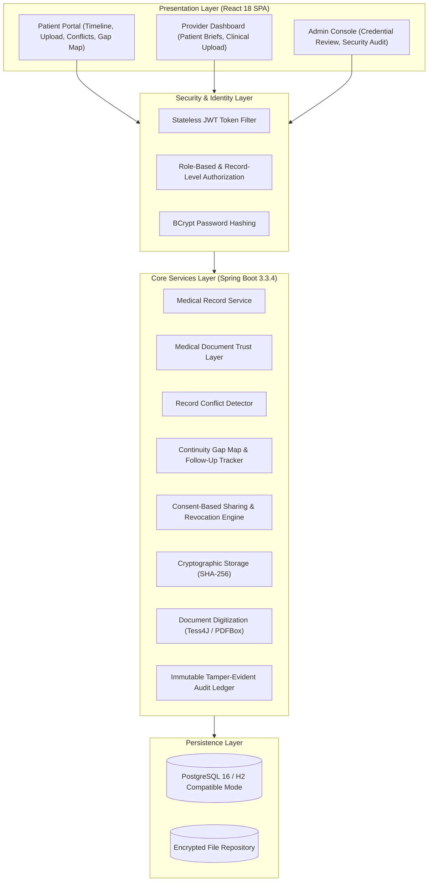

# CareTrail — An Intelligent Healthcare Continuity Platform

[](https://spring.io/projects/spring-boot)
[](https://react.dev/)
[](https://www.postgresql.org/)
[](https://jwt.io/)
[](https://maven.apache.org/)

CareTrail is an evidence-based healthcare continuity and medical record trust platform. It solves the critical problem of fragmented medical histories across hospitals, clinics, and laboratories by providing chronological consolidation, cryptographic SHA-256 document hashing, rule-based conflict detection, continuity gap mapping, source-linked clinical briefs, and patient-sovereign consent sharing.

---

## 1. System Architecture



---

## 2. All 18 Features Implemented

| # | Feature | Implementation Details |
|---|---|---|
| **1** | **Patient Medical Record Upload** | Validates file types (`.pdf`, `.jpg`, `.jpeg`, `.png`, `.txt`), enforces 25MB limit, stores securely, computes SHA-256 hash. |
| **2** | **Hospital/Clinic/Lab Direct Upload** | Approved providers upload clinical records for consenting patients; stamped as `ISSUER_CONFIRMED`. |
| **3** | **OCR-Based Document Digitization** | PDFBox & Tess4J extraction pipeline; parses dates, doctors, clinics, diagnoses, medications, and labs with confidence scoring. Supports patient corrections without mutating original files. |
| **4** | **Unified Medical Timeline** | Chronological aggregation across providers with facility, date, document type, and verification status. |
| **5** | **Medical History Search** | Multi-attribute search by date range, provider, document type, and extracted clinical text. |
| **6** | **Original Document Viewer** | Streamed via authenticated `/api/records/{id}/document` API endpoint with protected URLs and permission enforcement. |
| **7** | **Duplicate Record Detection** | Cryptographic SHA-256 hash detection and metadata heuristic checks; flags duplicates rather than deleting them. |
| **8** | **Medical Document Trust Layer** | Transparent multi-channel verification workflow distinguishing between registered doctors, cryptographic PKI signatures, and institutional confirmation for ordinary paper certificates. |
| **9** | **Issuer & Credential Verification** | Distinguishes between doctor registration status and specific certificate issuance. |
| **10** | **Record Conflict Detector** | Rule-based engine identifying conflicting dates, duplicate reports, mismatched patient IDs, and contradictory medication regimens (e.g. concurrent anticoagulants, sudden dosage leaps). |
| **11** | **Verification Status & Evidence Log** | Supports all 6 statuses: `PATIENT_UPLOADED_UNVERIFIED`, `ISSUER_CONFIRMED`, `DIGITALLY_SIGNED_VALIDATED`, `VERIFICATION_PENDING`, `DISCREPANCY_FOUND`, `UNABLE_TO_VERIFY`. |
| **12** | **Continuity Gap Map** | Proactive visual dashboard tracking missing post-discharge tests, conflicting info, unverified records, and unconfirmed follow-up orders. |
| **13** | **Follow-up Tracker** | Tracks clinical instructions as pending, completed, or unconfirmed with supporting evidence links. Does not generate autonomous treatments. |
| **14** | **Continuity Brief** | Source-linked concise summary for clinicians; every claim links to its source record with verification limitations explicitly labeled. |
| **15** | **Consent-Based Record Sharing** | Granular patient permissions (`FULL_TIMELINE`, `CONTINUITY_BRIEF_ONLY`, `SELECTED_RECORD`) enforced strictly on backend. |
| **16** | **Temporary Access & Revocation** | Configurable expiry (24h to 30d) with 1-click instant backend revocation. |
| **17** | **Access Audit Log** | Immutable append-only security ledger capturing views, uploads, sharing, revocation, and verification changes. |
| **18** | **Secure Access Control** | Stateless JWT tokens, role-based checks, BCrypt password hashing, path-traversal prevention, and no public document URLs. |

---

## 3. Database Schema (13 Relational Tables)

The database schema is defined in [schema.sql](file:///backend/src/main/resources/schema.sql):

1. **`users`**: Base credentials, full name, role (`ROLE_PATIENT`, `ROLE_PROVIDER`, `ROLE_ADMIN`), active status.
2. **`patient_profiles`**: DOB, gender, blood group, National Health ID, allergies, chronic conditions.
3. **`healthcare_providers`**: Hospital name, license number, department, verification status (`PENDING`, `VERIFIED`, `REJECTED`).
4. **`provider_credentials`**: Professional board certifications, authority, issue/expiry dates, verification evidence.
5. **`medical_records`**: Title, document type, record date, issuing facility, attending physician, verification status, duplicate flags.
6. **`document_metadata`**: Original filename, stored path, SHA-256 hash, file size, mime type, digital signature flag.
7. **`extracted_medical_data`**: Raw OCR text, extracted dates, provider, facility, diagnoses, medications, lab values, user corrections.
8. **`verification_requests`**: Outbound verification inquiries to issuing hospitals.
9. **`verification_events`**: Immutable evidence log tracking actor, old status, new status, method used, and evidence notes.
10. **`record_conflicts`**: Discrepancy comparator records storing conflicting values, sources, and human resolution notes.
11. **`follow_up_tasks`**: Documented clinical instructions, due dates, completion status, and evidence record references.
12. **`sharing_permissions`**: Patient-granted provider access records, scope, expiry timestamp, revocation reason.
13. **`access_audit_logs`**: Irrevocable security ledger recording user, target patient, action, IP address, user-agent, details.

---

## 4. Synthetic Demonstration Scenario

CareTrail includes realistic pre-seeded synthetic data for demonstration without contacting real providers or transmitting real patient information:

### Fictional Healthcare Providers
1. **St. Jude Regional Medical Center**
   - Clinician: Dr. Sarah Jenkins, MD (Cardiovascular Medicine)
   - Status: `VERIFIED`
2. **Metro Health Diagnostic Center**
   - Clinician: Dr. Robert Chen, MD (Clinical Pathology & Laboratory)
   - Status: `VERIFIED`
3. **Apex Urgent Care & Community Clinic**
   - Clinician: Dr. Emily Davis, DO (Family Medicine & Urgent Care)
   - Status: `PENDING` (Available for Admin verification workflow demonstration)

### Patient Persona: John Doe
- National Health ID: `CT-PID-100452` • Blood Group: `O+` • Allergy: `Penicillin (severe anaphylactoid reaction)`
- **Record 1 (St. Jude)**: Cardiology consultation diagnosing Essential Hypertension; Prescribing Metformin 500mg daily & Lisinopril 10mg daily (`ISSUER_CONFIRMED`).
- **Record 2 (Apex Urgent Care)**: Scanned paper prescription uploaded by patient prescribing Metformin 1000mg twice daily and Warfarin 5mg daily (`PATIENT_UPLOADED_UNVERIFIED`).
  - **Triggers Conflict**: Contradictory Metformin dosage and concurrent anticoagulation without documented bridging!
- **Record 3 (Metro Health Diagnostics)**: Glycated Hemoglobin Panel (`DIGITALLY_SIGNED_VALIDATED`).
- **Record 4 (St. Jude)**: Inpatient Hospital Discharge Summary (`ISSUER_CONFIRMED`).
  - **Triggers Continuity Gap**: Mandatory repeat HbA1c panel due post-discharge with no confirmed lab upload!

---

## 5. Quick Start & Setup Instructions

### Prerequisites
- **Java**: JDK 21+ (Compatible with JDK 21, 23, 26)
- **Node.js**: v18+ or v24+
- **Build Tools**: Maven 3.9+ (Included via `./tools/maven` and `mvnw`) and npm 10+

### Option A: 1-Click Launch Scripts (Windows)
1. Double-click `start-backend.bat` to boot the Spring Boot server on `http://localhost:8080`.
2. Double-click `start-frontend.bat` to boot the React SPA on `http://localhost:3000`.
3. Open your browser at `http://localhost:3000`.

### Option B: Command Line Setup

#### 1. Backend Setup
```powershell
cd backend

# Compile and run with the embedded PostgreSQL-compatible profile
.\mvnw.cmd spring-boot:run

# Or run automated tests
.\mvnw.cmd test
```
*Note: To connect to an external PostgreSQL server, pass `-Dspring.profiles.active=prod` with `DB_HOST`, `DB_NAME`, `DB_USER`, `DB_PASSWORD` environment variables.*

#### 2. Frontend Setup
```powershell
cd frontend

# Install dependencies (already installed)
npm install

# Start Vite development server
npm run dev
```

---

## 6. Demonstration Logins

Use the 1-click login buttons on the Landing Page or enter credentials:

| Role | Username | Password | Purpose |
|---|---|---|---|
| **Patient** | `john_patient` | `Password123!` | View consolidated timeline, review 2 active conflicts, inspect Gap Map, manage provider sharing. |
| **Provider** | `dr_sarah` | `DoctorPass123!` | View authorized patients, access source-linked Continuity Briefs, upload institutional records. |
| **Admin** | `admin` | `AdminPass123!` | Review Apex Urgent Care verification queue, approve credentials, monitor security audit log. |

---

## 7. Automated Test Suite

Run the full automated test suite verifying all 10 core components:
```powershell
cd backend
.\mvnw.cmd test
```

Tests verify:
- Patient registration and profile generation
- Password hashing and authentication prevention
- File validation, SHA-256 computation, and exact duplicate detection
- Non-destructive OCR field correction
- Verification status transitions and Trust Layer evidence logs
- Rule-based medication and temporal conflict detection & human reconciliation
- Consent-based sharing grants and instantaneous revocation
- Immutable access audit ledger entry creation
